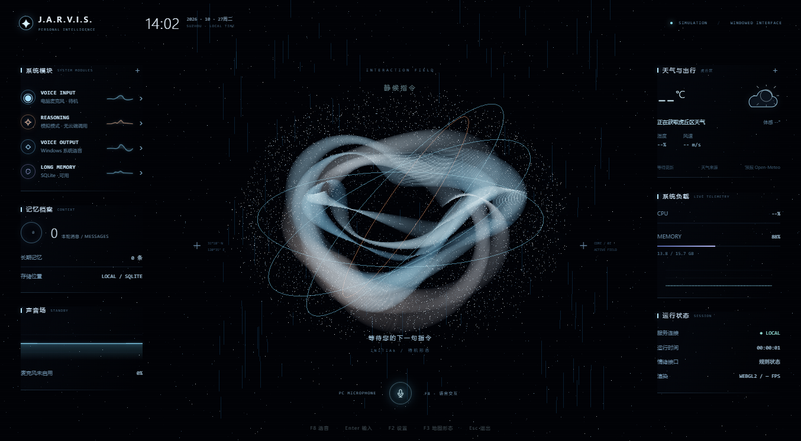

# JARVIS-OS

Windows 上的中文个人助手原型：Python 后端配合 Three.js 网页界面，用电脑麦克风和扬声器完成交互。中央能量体可重组成三维粒子城市，显示真实地图服务返回的导航路线。

## 当前功能

- 普通窗口运行的星海界面、能量带和细粒子；不默认全屏。
- 文本输入、F8 按键录音、可独立配置的语音识别、Windows 或云端播报。
- OpenAI-compatible Chat API；端点、模型、密钥均通过本机配置保存。
- SQLite 对话历史与显式长期记忆、日志、设备选择和 F2 设置页。
- 高德地点核验与驾车、打车、公共交通、步行比较；默认使用保存的常用起点。
- 中央局部楼宇、道路网和绿色路线粒子，约 2.6 秒展开或收拢；结束导航或切换到无关话题时恢复能量体。
- 虎丘区天气实况与单独注明来源的区域预报。

界面使用 Three.js / WebGL2，默认音频使用 Windows WinMM 和 System.Speech。对话模型在云端运行，无需在电脑上部署大模型。情绪模块目前为可解释规则接口，没有训练好的情感模型。

## 安装与启动

需要 Windows 10/11、Python 3.10+（建议 3.12，包含 tkinter）和 Microsoft Edge，浏览器需开启图形加速。默认功能只依赖 Python 标准库；Three.js 已随源码附带。可选音频后端依赖另列在 requirements-audio.txt。

当前程序严格要求唯一工作目录为 **F:\\Javis_os**，其他位置会提示错误。

首次安装到尚不存在的目标目录：

    git clone https://github.com/GXmind/JARVIS-OS.git F:\Javis_os
    cd /d F:\Javis_os
    start.cmd

也可下载源码并放到该目录，双击 start.cmd。启动脚本在项目下创建 .venv 和运行子目录。已有配置和数据不会自动覆盖；已有项目请先妥善备份，不要删除目录来强行重新克隆。

## 操作

| 操作 | 按键或方法 |
| --- | --- |
| 输入文字 | Enter，输入后提交 |
| 开始/停止录音 | F8 或麦克风按钮 |
| 设置模型、音频、地图凭证 | F2 |
| 手动展开/收起地图 | F3 |
| 调整特效质量 | F6 |
| 收起导航/关闭当前浮层 | Esc |
| 退出程序 | 主界面 Esc，选择退出 |
| 检查城市 | 拖动旋转、滚轮缩放，左侧切换街区或全程 |
| 切换路线 | 左侧打车、自驾、公共交通、步行 |

说或输入“贾维斯，我要去拙政园，帮我规划路线”，会使用 F2 保存的起点。也可明确说“帮我规划从苏州站到虎丘景区的路线，打车前往”。缺少起点或可靠地点匹配时会提示补充，不编造路线。

## 配置 API

首次启动从 config/.env.example 创建 config/.env。也可以在 F2 中填写；真实密钥不应提交到仓库。

| 用途 | 主要配置 |
| --- | --- |
| 对话 | CHAT_MODE=api，API_BASE_URL、API_MODEL、API_KEY |
| 录音转文字 | ASR_MODE=api，ASR_BASE_URL、ASR_MODEL、ASR_API_KEY |
| 播报 | TTS_MODE=windows / api / off，AUTO_SPEAK=true / false |
| 音频设备 | INPUT_DEVICE、OUTPUT_DEVICE；留空使用系统默认 |
| 高德地图 | AMAP_JS_KEY、AMAP_SECURITY_JSCODE、AMAP_CITY、AMAP_DEFAULT_ORIGIN |
| 天气 | WEATHER_CITY、WEATHER_ADCODE；虎丘区示例编码为 320505 |

对话、识别和播报是三项独立能力。DeepSeek 等文本对话接口不能直接承担录音识别；请为识别配置支持音频转写的服务。云端播报需要服务商支持 speech 接口。默认 mock 模式不调用云端；ASR 关闭时可用 Enter 输入文字。

高德凭证需申请“Web端（JS API）”类型及配套安全密钥。当前由本机代理转发受限的地图请求。地点先限定城市搜索，核实名称与地址后按坐标规划；同名歧义通过左侧候选选择，不直接接受服务自动猜测的异地终点。

## 地图表现与边界

导航路线来自高德，局部楼宇与道路矢量来自 OpenFreeMap / OpenMapTiles / OpenStreetMap，坐标转换后在同一 Three.js 场景渲染。建筑轮廓是真实地图数据，楼高可能为提供值或估计值，并有纵向视觉夸张；这不是测绘级数字孪生，也不是高德官方三维楼模。

街区视图保持局部城市大小，全程视图用于查看完整线路。城市数据不可用时会明确提示，不用随机建筑冒充真实楼宇。路线用时随路况变化，打车预估不含等车且不会下单。

没有 ESP32/MCXN947 硬件通信、持续唤醒词监听、自动驾驶或设备控制。训练目录仅提供规划、候选合成示例和微调配置参考，没有训练权重；示例需审核和划分数据后再用于训练。

## 数据与隐私

应用的源码、配置、录音、日志、缓存、数据库和临时文件均存放在 F:\Javis_os 的明确子目录。系统 Python、驱动和 Windows 语音服务来自系统安装位置。

- config/.env 保存本机密钥；data 保存 SQLite 历史与记忆。
- recordings 保存录音；cache 保存音频和地图缓存；logs 保存日志；tmp 保存临时文件。
- 这些私人运行目录、虚拟环境和历史备份均被 .gitignore 排除。
- 启用云端对话会发送当前输入与有限上下文；语音识别会发送录音；云端播报会发送待合成文本。地图请求会发送起终点，可能消耗服务商额度。
- 密钥、数据库与录音目前没有应用层加密；请自行保管并定期备份。

公开仓库不包含真实密钥、录音、聊天历史、私人住址、运行日志、训练权重或本机环境。测试中的地点为公共景点或通用样例。

## 检查与测试

在 F:\Javis_os 下运行：

    .\.venv\Scripts\python.exe -B main.py --self-check
    .\.venv\Scripts\python.exe -B main.py --smoke-ui

单元测试：

    scripts\test.cmd

几何和地点匹配测试需要 Node.js 22+，不需要安装 npm 依赖：

    npm test

实际录音与系统播报自检：

    .\.venv\Scripts\python.exe -B main.py --self-check --audio --tts

麦克风测试会实际录音；播放调用成功不能代替人耳确认音质。常规浏览器自检使用模拟 SDK 和独立数据库，不使用真实地图凭证；真实服务联调需要使用者自行配置。当前检查范围与结果见 [开发验证](docs/verification.md)。

## 项目结构

    main.py                         固定根目录与启动引导
    src/jarvis/bootstrap.py         服务装配
    src/jarvis/domain/              纯规则与状态
    src/jarvis/application/         会话、对话用例与可替换端口
    src/jarvis/infrastructure/      API、音频、数据库、配置、地图及天气
    src/jarvis/presentation/        HTTP、桌面窗口、网页与历史 Tkinter
    src/jarvis/diagnostics/         自检与浏览器验证
    config/.env.example             无密钥配置模板
    scripts/、tests/                启动、回归与压力检查
    training/、docs/                训练设计与文档

更多说明见 [架构与模块](docs/architecture.md) 和 [开发验证](docs/verification.md)。

## 许可

项目沿用仓库现有的 [Apache License 2.0](LICENSE)。Three.js 使用 MIT，eviltransform 使用 BSD，原始许可随相应文件附带。地图数据及归属说明见 [THIRD_PARTY_NOTICES.md](THIRD_PARTY_NOTICES.md)。

## 地图功能

地图模块改善近景几何、建筑内院和底高，增加 ×1–×32 楼高强调与完整水平环绕、俯仰、平移、缩放及复位。详见 [地图更新说明](docs/map-update.md)。

全程与浏览修订：默认显示完整起终点和周边路网；左键拖动移动地理视野，右键/Shift 拖动环绕，滚轮放大加载街区。“查看全程”恢复整段路线，地图不会覆盖两侧状态栏。

渲染卡顿与退出的修订及可复现压力检查见 [稳定性说明](docs/map-stability.md)。

## 开发与维护

| 说明 | 内容 |
| --- | --- |
| [协作说明](CONTRIBUTING.md) | 分支、数据保护、验证与提交约定 |
| [构建与运行](BUILDING.md) | Windows 环境、一键启动、手动准备及测试 |
| [API 申请与配置](docs/API_SETUP.md) | 高德、对话、识别和播报的申请与配置 |
| [架构说明](docs/architecture.md) | 模块、状态流程、存储与数据边界 |

地图更新已由 [PR #1](https://github.com/GXmind/JARVIS-OS/pull/1) 合入 main。软件结构采用分层与端口适配器，新增能力的落点和依赖规则见协作及架构说明。

## 摄像头手势与独立地图（feature/map-operation-hand）

F9 开关本机摄像头手势：捏合拖动、食指旋转、双手捏合开合缩放，张掌停留后朝目标屏划动，地图化作粒子离屏，并在副屏汇聚重组。主屏恢复能量体并保留语音；副屏地图独立操作和关闭，主屏后续任务不会覆盖它。底部提供目标屏幕与明确的手势操作目标。安装、手势及限制见 [手势地图说明](docs/hand-map.md)。

## 本机语音唤醒

安装 `scripts/install_wake.cmd` 后，在主窗口说 **Hi Jarvis**，等提示音再说指令，停顿自动提交。F10 开关，F2 调整等待时间、句末静音和输入设备；中文指令使用独立 ASR。见 [唤醒说明](docs/voice-wake.md)。

地图采用后台几何构建和 GPU 缓冲复用。划屏遵循隐藏预热 → 主屏粒子离屏 → 副屏粒子接收 → 地图与文字界面重组，副屏内容保持独立。

## 自由提示词与中心交互

按 **F4** 直接输入任何绘制提示词，或说“画一幅……”“帮我建模……”。云端按完整描述生成自由路径、曲面、网格和构件动画；内置造型仅用于离线演示。可继续描述修改细节，或拖动旋转、滚轮缩放、说“散开/重组/暂停动画”，Esc 收起或取消。

中心新增聆听、辨识、思考、回应、构形等运动状态，采用靛蓝紫色星空配色。地图和模型保持各自专门形态。语音使用流式接收、预热系统引擎和连续输出；F2 分别调整对话速度与绘制思考强度。详见 [自由粒子交互](docs/center-actions.md)。

待机能量体持续呼吸和流动；主窗口与独立地图窗口采用暗色边框，保留普通窗口与缩放操作。桌面原生客户端、全屋/电脑控制与便携粒子三维终端的最新研究见 [修订架构方案](docs/client-and-portable-architecture.md)。便携端现定位为连接安卓手机的腕上粒子三维终端，优先体积与续航；不要求使用 Unity。本文档是规划，尚未完成相关移植与设备接入。
