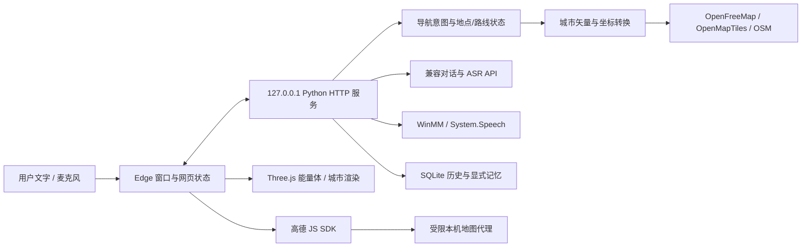

# 架构说明

默认入口是 Python 本机服务与 Edge 网页窗口。早期 tkinter 模块仍保留，但不是当前默认交互界面。应用运行根目录严格为 F:\Javis_os。

## 模块关系

浏览器中的地图控制器调用受令牌保护的本机 API 获取配置和城市上下文，使用高德 SDK 做地点与交通查询，再把真实结果交给同一 Three.js 场景。这里没有独立打开的平面地图窗口。

## 入口与生命周期

main.py 校验固定根目录，初始化子目录、日志、配置和应用锁。desktop.py 创建本机服务与普通窗口，并处理状态轮询、后台任务、配置、音频设备和退出。

浏览器通过 scene.js 更新状态栏与快捷键；visual.js 负责能量体、粒子与后处理；city.js 负责建筑、道路和路线的三维表现。渲染与服务使用独立状态，不用聊天模型文字代替地图成功回执。

导航主流程：

1. navigation.py 识别明确出行意图，确定常用起点或本次指定起点。
2. navigation.js 使用本市 POI 搜索，核对名称、城市和坐标。places.js 区分真实景区与同名泛地名。
3. 不够明确时进入 await_choice，中央提示左侧选择；确定后继续。
4. 驾车、公交和步行请求分别使用独立端点数组，组装打车、自驾、公共交通、步行方案。
5. 城市数据准备后，能量体约用 2.6 秒重组为粒子城市。
6. 结束导航或转到无关话题后，旧请求被版本号隔离，城市反向收拢。

等待、失败和完成是不同状态。旧的后端播报字幕不能盖住地图等待选择或错误说明。

## 音频与字幕

audio.py 与 native_audio.py 负责设备适配、录音和播放。默认 WinMM 通过排队缓冲持续播放，System.Speech 在后台生成音频。字幕时间点来自生成音频的样本位置，按行前进。

语音链路为录音 → ASR → 对话或导航 → TTS。ASR 可独立配置服务和凭证；Windows TTS 无需云端 Key。后台工作避免阻塞界面；网络请求和正在生成的音频仍受各自超时与取消机制约束。

## 地理数据边界

- 高德：POI、交通路线与优先天气实况，使用 GCJ-02。
- 城市背景：OpenFreeMap/OpenMapTiles/OSM 矢量，原始瓦片坐标经转换后与路线对齐。
- city_data.py：限制范围、下载并发、缓存和返回预算。
- vector_city.py：读取 MVT，转换建筑与交通几何。
- eviltransform：坐标转换，原始 BSD 许可保留。

数据源近似高度和显示夸张不能当作实测楼高。OpenMapTiles 的建筑字段含 render_height、render_min_height 和 hide_3d，其定义见 [官方 schema](https://openmaptiles.org/docs/schema/)。可用矢量层和覆盖受数据源限制；当前数据源的最高层级为 z14，不等于任意地点都具备完整高精建筑模型。

## 存储、配置与安全边界

| 目录/模块 | 用途 |
| --- | --- |
| config/.env | 本机配置与明文凭证，排除出 Git |
| data | SQLite 对话、显式长期记忆和导出 |
| recordings | 电脑麦克风录音 |
| cache | 合成语音、浏览器 profile、城市瓦片 |
| logs | 本机日志和自检报告 |
| tmp | 临时文本、锁和隔离测试数据 |
| storage.py | 短连接 SQLite 访问 |
| config.py | 字面量 .env 读取、校验和原子保存 |
| logging_setup.py | 日志轮转和已知密钥过滤 |

本机界面请求使用每次运行的令牌。地图代理校验本机 Host/Origin/cookie，只转发固定地图路径；API 密钥和安全码不跟随任意重定向。JS SDK 必需的 JS Key 会到浏览器，安全密钥由本机代理处理。

这些措施不构成公网多用户认证系统。程序没有暴露公网服务、执行任意电脑命令或控制外部 MCU 的能力。

## 状态与可替换接口

Conversation 连接云端对话、历史与显式记忆；长期记忆当前是透明规则检索，不是向量数据库。EmotionProvider 的当前实现返回规则标签、原因、来源和 trained_model=false。训练目录仅为参考与待审核候选数据，没有模型权重。

服务商、语音后端、情绪实现和城市数据层可按模块替换，但要保留真实结果与模拟结果的区别。

## feature/map-update 的独立变更

本次 main 只维护说明，功能仍在 feature/map-update：

- 建筑内环归属、底高和 hide_3d 处理，局部过滤与去重。
- 默认更近的街区显示范围和独立楼高强调。
- map_controls.js 统一处理连续水平环绕、俯仰、平移、缩放、双指和复位。
- 主路、支路、步道与有限道路文字层；顶点地理坐标保持来源，不通过挪动地图“贴合”路线。

该分支的功能说明与测试以其 docs/map-update.md 和实际代码为准；没有自动合并到 main。

该功能分支后续已补充默认完整起终点适配、完整折线保留、地理视野拖拽和缩放、按区域选择全程路网层级，以及避免覆盖侧栏的中央绘制范围。主分支仍仅维护说明，实际交互以 feature/map-update 的文档和代码为准。
