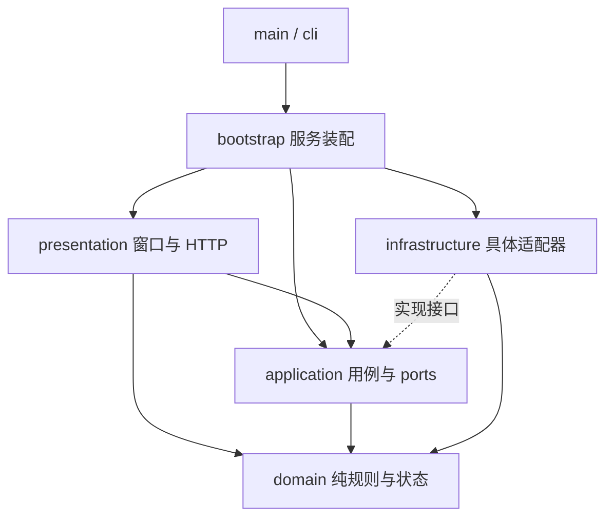

# 软件架构

默认形态仍为 Python 本机服务 + Edge 普通窗口 + Three.js 粒子场景。采用轻量分层架构及端口/适配器，使用标准库，不引入服务容器、打包器或额外运行框架。唯一运行根目录为 `F:\Javis_os`。

## 目录与职责

```text
main.py                         固定目录检查、缓存环境准备；调用 CLI
src/jarvis/
  cli.py                        参数、单实例锁、自检与启动错误提示
  bootstrap.py                  正式运行的唯一服务装配入口
  domain/
    settings.py                 Settings、纯校验、公开地图配置
    navigation.py               导航意图与 NavigationBridge 状态
    emotion.py                  可解释情绪规则与接口
    text.py                     播报分行规则
    errors.py                   可安全呈现的 ServiceError
  application/
    ports.py                    存储、云端、音频、天气、遥测接口
    conversation.py             对话上下文、显式记忆及模型调用流程
    session.py                  会话、后台任务、录音/播报、设置用例
  infrastructure/
    config/env_file.py          字面量 .env 读取与原子保存
    persistence/sqlite.py       历史、记忆及统计；短连接 SQLite
    http/                       兼容云端协议、禁止重定向策略
    audio/                      音频服务、Windows WinMM
    maps/                       高德安全代理、城市上下文、MVT 解码
    weather/                    天气获取与缓存
    system/                     固定路径、日志、系统遥测
    vendor/                     坐标转换及原始许可证
  presentation/
    web/server.py               loopback HTTP、令牌、协议与状态响应
    web/security.py             地图代理 cookie/来源校验
    web/assets.py               限定资源目录与旧 URL 兼容
    web/assets/                 网页模块，详见下表
    desktop/window.py           Edge 窗口、拖动、Windows 生命周期
    legacy/                     早期 Tkinter 界面，仅保留兼容诊断
  diagnostics/                  基础自检、Chromium 检查及 DevTools 客户端
```

`bootstrap.create_state()` 装配会话端口，`create_server()` 装配 HTTP 服务依赖。测试可直接构造 `SessionServices` / `HttpServices`，替换云端、音频和配置写入，不需要真实凭证、麦克风或桌面。使用 `Conversation` 的云端模式时必须注入 `cloud_factory`；未装配时给出明确错误，模拟模式不访问云端。

## 依赖方向



- domain 不导入其他层，不读文件、数据库、网络或设备。
- application 只依赖 domain 和自身端口；不能创建 CloudAPI、Audio、Store，不能执行 SQL。
- infrastructure 实现外部服务，不反向导入界面或装配入口。
- 默认 presentation 只处理交互和传输。HTTP 通过注入的服务调用地图代理、城市数据和设备列表。
- 平台窗口读取 `infrastructure.system.paths.ROOT` 是明确的路径依赖；早期 `presentation/legacy` 仍保留原有直接装配逻辑，不作为新功能入口。
- `tests/test_architecture.py` 自动检查上述导入方向及资源目录边界。

## 网页结构

| 目录 | 职责 |
| --- | --- |
| app.js | 组装交互、轮询、键盘、字幕与窗口动作 |
| core/client.js、state.js、dom.js | 带令牌的本机请求、共享运行状态、DOM 查找 |
| ui/hud.js、weather.js、settings.js | 状态栏、天气刷新、F2 配置表单 |
| features/navigation/controller.js | 地点选择、各方式路线、请求版本与地图状态 |
| features/navigation/routes.js | 纯坐标、折线、公交路线及起点优先级规则 |
| features/navigation/sdk.js | 高德 SDK 加载、超时与服务错误解释 |
| features/navigation/places.js | POI 评分与歧义识别 |
| features/map/controls.js | 平移、缩放、连续 360° 环绕、双指与复位 |
| rendering/energy.js、shaders.js | 能量体、粒子、后处理与着色器 |
| rendering/city_geometry.js | 不依赖 DOM/GPU 的建筑、道路、完整路线几何 |
| rendering/city.js | Three.js 对象、GPU 缓冲、标签与资源更新 |
| styles/main.css、vendor/ | 原样式、Three.js 与原始许可证 |

HTML 使用原生 ES Modules，不需要 Vite/Webpack。canonical 资源地址随目录组织；旧 `/scene.js`、`/navigation.js`、`/city.js` 等 URL 由本机内存兼容响应转到新模块，避免旧诊断立即失效。旧 Python 平铺模块已经迁移，工具必须改用新包路径，不增加多套转发文件。

## 运行与导航流程

1. main 准备根目录和缓存环境，cli 处理参数、日志、配置与单实例锁。
2. bootstrap 构造适配器、会话和 HTTP 服务；窗口层启动 Edge 普通窗口。
3. 文本或录音交给会话后台任务；录音经独立 ASR，再进入导航或对话。
4. domain 导航规则优先使用本次明确起点，否则使用 F2 常用地址；缺少起点进入等待。
5. 前端导航控制器核对本市真实 POI，歧义等待左侧选择，再查询打车、自驾、公交与步行。
6. 高德返回真实路线；城市上下文由公开矢量数据构造。粒子能量体约 2.6 秒重组为城市，结束导航或无关话题后收起。
7. HTTP 退出请求或窗口关闭触发生命周期清理；停止音频、等待后台工作，再释放设备和本机服务。

保持请求版本隔离、最多一个城市请求执行和最新视野合并。全程折线保留，初始适配起终点；地理拖动和缩放会加载新街区。GPU 缓冲复用、粒子预算与地图后处理减负仍保留，详见 [稳定性说明](map-stability.md)。此次重构不更改界面布局、配置字段、SQLite schema 或路线算法。

## 数据与安全

| 路径 | 用途 |
| --- | --- |
| config/.env | 本机明文配置与密钥；不提交 |
| data/ | SQLite 对话、显式记忆 |
| recordings/ | 麦克风录音 |
| cache/ | 音频、城市瓦片、浏览器 profile |
| logs/ | 轮转日志、自检报告 |
| tmp/、backups/ | 临时文件、锁、隔离测试与本机备份 |

高德 POI/路线采用 GCJ-02；OpenFreeMap/OpenMapTiles/OSM 城市几何经坐标转换对齐。数据最高层级与覆盖有限，未知楼宇不使用随机建筑填充；高度强调与源高度分离，不代表实测高度。保留地图归属及第三方许可。

本机 HTTP 仅绑定 127.0.0.1。请求校验每次运行的令牌、Host/Origin；地图代理仅转发受限路径并禁止重定向泄漏凭证。JS Key 用于浏览器 SDK，安全密钥留在 Python 代理。资源访问限制在 assets 目录。不是公网多用户服务。

对话、ASR、TTS 是不同能力；独立 ASR 地址必须使用独立密钥。Windows 播报仍由后台 System.Speech 生成音频、WinMM 排队播放，字幕按样本位置分行。长期记忆为显式保存和透明检索；情绪为可解释规则，`trained_model=false`，没有已训练情感模型。

## 验证与迁移

见 [构建说明](../BUILDING.md) 的完整命令和 [协作说明](../CONTRIBUTING.md) 的功能落点。新增接口需要无网络/无设备的替身测试；跨层导入由架构测试约束。结构变更还需前端几何、真实浏览器正反向动画及地图压力检查。真实服务联调与合成 SDK 测试分开记录。

源代码迁移前在根目录 backups 中留存本机备份。用户 .env、数据库、录音及缓存不迁移、不改名；旧启动命令、快捷键和 HTTP API 保持兼容。直接导入旧 Python 模块的个人工具需要按本页路径更新。


## 手势与多窗口扩展

主窗口通过 MapWorkspace 冻结一次传送种子；后续主屏快照和视角与这个种子隔离。副屏有自己的 NavigationController 和城市数据请求，独立操作、切换已有出行方案、加载街区和退出。主屏对话、重新规划和结束导航不能覆盖或关闭副屏；副屏也不需要主屏网页持续轮询。两者仍复用 Python 本机数据服务，全局退出关闭整个应用。

副屏令牌允许地图种子、动作队列、城市上下文和关闭自身，拒绝音频、对话、设置和全局退出。摄像头只在主屏运行，用户明确选择操作主屏或副屏。动作仅投递到选定目标；图像不进入 Python 或其他窗口。

GPU 传送过程将道路和建筑等真实几何采样成有预算的粒子流，按实际目标方向离屏，在目标网页从相反边缘汇聚重组。主屏能量体在离屏末段恢复；窗口保持普通尺寸。无桌面透明覆盖层。架构与完整操作见 [手势地图](hand-map.md)。
