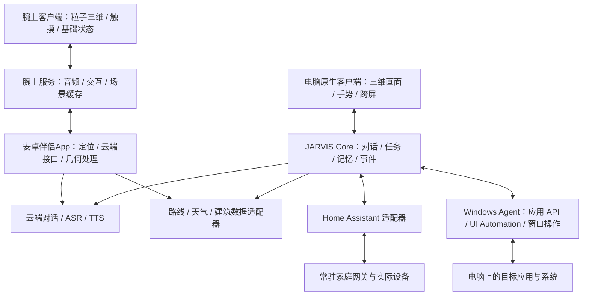

# 桌面客户端与粒子三维便携端：修订架构方案

日期：2026-10-29。根据用户补充，桌面客户端与便携板卡分别选技术；便携端裁剪功能，保留与客户端相近的粒子三维界面。本文件取代上一版分析中把便携方案绑定到 Unity、或默认降为二维地图的选型前提。最新补充：便携设备约手表大小或略大，用户已选择连接安卓手机，优先体积和续航。因此先前RK3588级独立终端不再作为腕上产品基线。以下均为设计建议，尚未更换渲染引擎、接入全屋设备或完成板卡实测。

## 1. 两个产品的明确边界

| 项目 | 电脑客户端 | 便携板卡 |
| --- | --- | --- |
| 对话、语音、天气和导航 | 保留 | 保留 |
| 能量体、粒子三维地图、状态栏风格 | 完整交互和特效 | 保留相近视觉语言，按小屏与功耗控制密度 |
| 自由建模、复杂动画、手势跨屏 | 继续扩展 | 第一阶段不要求 |
| 全屋智能、电脑控制 | 重点扩展方向 | 第一阶段不要求承担控制中枢 |
| 运行依赖 | 电脑本机服务 | 腕上本地绘制，安卓手机负责联网、定位和云端服务；电脑关闭仍可用 |
| 图形技术 | Unity、Godot、UE、Qt 等重新比较 | 优先原生GPU渲染；按手表系统能力选择，不要求 Unity 或浏览器 |

便携端的“基础功能”不代表普通二维界面，也不代表把电脑画面视频投到小屏。地图几何、路线粒子和能量体应在板卡 GPU 上实时绘制，触摸旋转和缩放在本地响应。只精简任务种类和运行开销。

## 2. 网页限制需要拆开判断

当前原型存在三个独立的问题域：

1. **视觉与交互制作：**空间场景、粒子形变、拾取、三维房间、复杂动画和多窗口协作，目前大量依赖手写代码。原生引擎的场景编辑器、动画工具、GPU 粒子和输入系统，能改善制作和维护流程。
2. **系统能力入口：**普通网页受到浏览器权限和生命周期约束。桌面外壳加本机服务也可以桥接原生能力，例如 WebView2 官方支持网页与宿主消息交互。因此不能把“网页不能直控设备”推导为“必须换游戏引擎才能控制”。[WebView2 原生桥接](https://learn.microsoft.com/en-us/microsoft-edge/hosting/webview2/gettingstarted)。
3. **目前服务尚未接入：**全屋设备发现、状态订阅、Windows 应用操作和任务执行，本项目还没有完整适配器。换 Unity/UE 不会自动补齐这些服务；它们需要独立设计。

用户希望扩展原生客户端是合理的产品方向，但应同时升级能力服务，避免只换了画面，电脑和家居的连接方式仍停留在原型阶段。渲染卡顿也需要区分网络、几何构建、GPU 填充率与音频链路，不能承诺换引擎全部解决。

## 3. 推荐架构：原生画面与能力服务分离

这是一种共享协议和能力模型、分别部署客户端的设计，并不要求所有功能都运行在同一台服务器。腕上端保留本地画面、交互和路线缓存，安卓手机承担主要在线能力，正常使用不依赖电脑在线；手机断连时不能假定在线对话、位置和路线仍会更新。需要跨端记忆或家居远程操作时，再明确增加同步与授权网关。

### Core 与协议

先保留 Python 对话、记忆、地图规则和验证，增加明确的能力注册、任务编排与事件接口。让视觉客户端只提交动作并订阅状态，例如：

- `navigation.plan`：起点、终点、出行方式；
- `device.set`：已发现设备、目标属性和值；
- `desktop.open_app`、`desktop.arrange_window`：明确应用和窗口；
- `scene.show`：经过验证的路径、曲面、网格和动画数据。

动作返回 `task_id`，状态区分已接收、执行中、完成、失败、取消；事件携带版本、来源和目标客户端。模型提出结构化任务，服务核对能力与参数后执行，不把自然语言或生成代码直接当作系统命令。设备真实状态决定完成反馈，不能只因模型说“已开灯”就播放成功动画。

本机优先使用带身份的 loopback HTTP/WebSocket 或命名管道；跨设备另设 HTTPS/WSS 网关。当前 HTTP 接口可作为过渡，不能假定任务总线、WebSocket 和 Windows Agent 已经存在。三维粒子不逐帧走网络：传场景参数、路线、几何版本和事件，客户端持续渲染。

### 电脑控制

按目标应用能力依次使用应用官方 API/插件、Windows 系统接口、UI Automation，最后才考虑屏幕识别与鼠标键盘模拟。UI Automation 可以读取和操作许多应用暴露的控件，但并非覆盖所有软件或所有自绘界面。[Microsoft UI Automation](https://learn.microsoft.com/en-us/windows/win32/winauto/uiauto-uiautomationoverview)。

建议 Windows Agent 作为独立进程，C#/.NET 或 Python 先实现有明确边界的动作；引擎通过协议调用。录音、TTS、应用操作和网络请求放在渲染主循环之外。用户说“打开应用，放到右侧屏幕”，应先收到实际窗口结果，再驱动空间面板和粒子反馈。

### 全屋智能

优先通过 Home Assistant 接入现有品牌和协议生态；JARVIS 负责自然交互与三维房间表现。Home Assistant WebSocket API 提供动作调用和状态订阅，MQTT 适合接入自制 ESP32/传感器等设备，不等于所有商品都能直接使用 MQTT。[HA WebSocket](https://developers.home-assistant.io/docs/api/websocket/)、[HA MQTT](https://www.home-assistant.io/integrations/mqtt)。

例如“客厅灯调暗”：Core 解析客厅与灯，适配器调用实际设备实体，等待状态回执，客户端再更新房间光效。区分平台接受命令与硬件已确认；不提供回读的设备可标注推测状态。

家居网关适合放在常驻小主机、NAS 或独立网关上，不让便携电池设备承担全屋常驻中枢。桌面客户端关闭时，家庭原有自动化仍可运行。具体品牌是否支持、本地或云端连接方式、是否需要 Zigbee 协调器或 Thread 边界路由器，都按实际设备决定。

## 4. 电脑客户端：Unity、UE 与其他方案

| 方案 | 对 JARVIS 有价值的能力 | 主要代价 | 当前判断 |
| --- | --- | --- | --- |
| Unity + URP | 场景和动画编排、Shader/GPU 粒子、三维交互、C# 生态 | 需重写现有视觉层，窗口与系统能力仍需 Agent；包体与资源要控制 | 科幻互动为重点时优先验证 |
| Unreal Engine + Niagara | 粒子、材质、复杂空间和高质量视觉制作 | 开发环境与高质量场景的硬件负担较大，C++/插件和桌面窗口适配工作较多 | 有足够显卡资源、追求高规格场景时再选 |
| Godot | 三维场景、自定义 GPU 粒子 Shader、原生扩展 | 现有网页渲染仍要重写，部分工具链需自行实现 | 与 Unity 做小型对照原型 |
| Qt Quick + Qt Quick 3D | 原生桌面控件、窗口、C++/Python 生态与三维内容混合 | 高自由度特效需自行制作，不能假定比游戏引擎更省资源 | 系统工具和桌面管理比场景演出更重要时考虑 |
| WebView2 等桌面宿主 + 现有网页 | 复用代码，增加原生桥接，快速验证控制能力 | 大部分视觉制作仍沿用目前网页技术 | 过渡方案，不代替用户希望的原生视觉验证 |

Unity 的 VFX Graph 有图形 API 与硬件要求，尤其不能把全部平台支持一概而论；Godot 官方提供 GPU 粒子和自定义粒子 Shader；Qt Quick 3D 支持二维/三维混合和 Particles3D。[Unity VFX 兼容性](https://docs.unity3d.com/Packages/com.unity.visualeffectgraph@17.3/manual/System-Requirements.html)、[Godot 粒子](https://docs.godotengine.org/en/stable/tutorials/3d/particles/index.html)、[Qt Quick 3D](https://doc.qt.io/qt-6/qtquick3d-index.html)、[Qt 粒子](https://doc.qt.io/qt-6/qml-qtquick3d-particles3d-particlesystem3d.html)。

UE Niagara 很适合视觉制作；Epic 官方推荐开发硬件列出32GB内存与8GB以上显存，这是开发建议，不是每个打包程序的运行下限。考虑目前电脑较弱，不能先认定 UE 是最佳落点，也不能承诺迁移后必然更流畅。[Niagara](https://dev.epicgames.com/documentation/en-us/unreal-engine/creating-visual-effects-in-niagara-for-unreal-engine)、[UE 硬件建议](https://dev.epicgames.com/documentation/unreal-engine/hardware-and-software-specifications-for-unreal-engine)。

**当前建议：以 Unity URP 为桌面视觉首选候选，Godot 为对照；先通过真实工作负载测试再定。**测试同一能量体、粒子地图、状态栏和两窗口转场，记录低分位帧率、帧时间、显存/内存、待机功耗和音频连续性。不要同时完整重写四套客户端。

系统控制的自由度来自能力服务与协议，视觉自由度来自场景、Shader、输入和动画工具。两者分别验收。

## 5. 腕上便携端：安卓手机协作、本地粒子三维

### 尺寸改变硬件路线

用户目标是手表大小或略大，并已确认允许连接安卓手机、优先体积和续航。“大一倍”尚未被定义为长宽或面积，因此不把它写成已确定的机械尺寸。可先以表体宽约50–60mm、1.6–2.0英寸级屏作为讨论目标；厚度、电池和天线空间需要结构堆叠验证，不能把目标当作已经完成的整机尺寸。

RK3588开发板、Pi开发板以及其载板/散热/电池组合不再作为腕上终端的默认方案。即使CM5本体也约55×40×4.7mm，还不包含载板、屏幕、电池和天线；模块尺寸不等于整机尺寸。[CM5规格](https://www.raspberrypi.com/products/compute-module-5/)。

### 手机与腕上的分工

| 安卓手机伴侣App | 腕上设备 |
| --- | --- |
| 联网调用对话、ASR与TTS | 麦克风采集、触摸/按键、震动与按需音频播放 |
| 获取手机定位，计算路线进度、处理偏航 | 显示导航位置、下一转向和路线粒子 |
| 查询路线、天气、建筑数据并简化几何 | 缓存局部场景，使用本地GPU绘制能量体和三维城市 |
| 管理会话、更新包与场景版本 | 本地旋转、缩放和转场动画，显示连接与数据新鲜度 |

腕上渲染不采用持续视频投屏作为基线。手机发路线、局部建筑/点云、关键状态和必要的压缩语音；手表在本地画出每一帧，触摸旋转无需等手机返回视频。地图数据随视口或路线变化更新，位置等状态按需要更新，不逐帧发送全部粒子坐标。使用分块、版本号、取消与重连快照，避免几何队列堆积。

Wear OS可用MessageClient处理小型指令、DataClient/Asset同步场景资源、ChannelClient承载流式传输。消息不能假定自动重试成功，音频吞吐和丢包需在实际手机/手表组合上测试。[客户端类型](https://developer.android.com/training/wearables/data/client-types)。

Wear OS Data Layer依赖Google Play services，主要用于Wear OS与配对安卓设备；不能只因手机是安卓就认为国内环境必然可用。无此条件时，应选择开放安卓穿戴方案提供的通信SDK，或在厂商支持下实现自定义蓝牙通道，并分别验证后台连接、音频和重连。不能把Data Layer的可用性扩大到所有安卓/鸿蒙手表。[Data Layer要求](https://developer.android.com/training/wearables/data/overview)。

### 硬件方向与原型顺序

| 选择 | 对当前目标的用途 |
| --- | --- |
| 能安装自研App、提供原生3D GPU接口的智能手表 | 第一阶段验证真实尺寸下的粒子观感、触摸、手机协作与功耗 |
| 带3D GPU的成熟可穿戴主板/模组 | 定制阶段优先路线，要求供应方提供系统/BSP、显示与音频支持及通信SDK |
| W5/W5+等可穿戴SoC平台 | 平台能力参考，最终以可获得的主板/模组和开发权限选择；不是对某块零售开发板的保证 |
| ESP32-S3、ESP32-P4等MCU | 可做低密度点投影、线框或外围控制；不作为保持当前丰富粒子城市的保真首选 |

Qualcomm W5/W5+官方资料列出可穿戴主处理器与Adreno 702 GPU；主SoC的3D能力与低功耗协处理器的2.5D显示能力需要区分，不能假定省电核能持续承载完整城市。[W5/W5+产品资料](https://docs.qualcomm.com/bundle/publicresource/87-43671-1_REV_B_Snapdragon_W5__and_Snapdragon_W5_Gen_1_Wearable_Platforms_Product_Brief.pdf)。ESP32-P4的数据手册主要列出PPA、2D-DMA等图像处理能力，不应将其等同于OpenGL ES 3D GPU。[ESP32-P4资料](https://documentation.espressif.com/esp32-p4_datasheet_en.html)。

确定供应商前至少验证：可安装和调试自研应用；能创建实际硬件加速的3D图形上下文；屏幕、音频和蓝牙接口开放；提供整板尺寸、持续工作功耗和散热条件；系统能够按目标方式维护升级。完成这些验证后再确定芯片与模组型号，不单凭主频或RAM购买。

### 渲染与界面

腕上优先原生OpenGL ES等图形接口，按选定设备实际支持版本实现点云、线框、Shader与低开销辉光。Android API存在不代表每块设备已经提供对应驱动，需要检查实际图形上下文。[Android OpenGL ES](https://developer.android.com/develop/ui/views/graphics/opengl/about-opengl)。

Wear OS不应假定有可用WebView，因此不能照搬上一版“Chromium加现有网页”的部署方式。[Android WebView兼容说明](https://developer.android.com/develop/ui/views/layout/webapps/managing-webview)。第一版做JARVIS应用，普通表盘或息屏显示另按系统能力设计，不把任意三维渲染器与表盘能力混为一谈。

保留靛蓝紫色能量体、呼吸流动、粒子纤维、能量体到城市的变形、三维建筑与路线流动。重排为中心三维画面、少量天气/导航提示、逐句字幕、可展开状态；不把电脑左右两列小字原样缩小到表盘。保留完整路线概览与局部街区视图，不能因裁剪当前街区而丢失目的地。

可先在约400–500像素级屏上尝试数千粒子、20–30 FPS的交互实验，具体预算由实测调整。数字不是硬件保证。地图采用真实路线与具有许可的真实建筑几何，手机统一坐标、处理缺失数据与版本，不使用随机城市冒充实景。

### 续航、语音与实时更新

Google的功耗指南明确建议利用手机承担部分网络和同步工作，腕上设备接收数据变化；持续亮屏、复杂动画、定位和无线通信仍会消耗电池。[Wear OS功耗指南](https://developer.android.com/training/wearables/apps/power)。

设计三档：抬腕交互时显示完整粒子；可见待机时按功耗预算低帧呼吸；息屏/环境显示按系统限制停止完整三维渲染。持续三维导航与短时抬腕使用分别测续航，不能用待机成绩宣传连续导航时间。

例：假设500mAh、3.85V电池，85%有效利用，约可用1.64Wh；若整机平均0.8W则约2小时，若全天使用的平均功耗降至0.08W则理论约20小时。这只是算术示例，尚未测量，不是本项目续航承诺。

语音由腕上采集、手机调用ASR和对话，再传压缩语音供腕上播放或由手机/耳机输出。系统允许的后台录音、持续唤醒与低功耗DSP访问需要单列验证，不能认定普通第三方App自动拥有可自定义的常开唤醒能力。

定位优先借用手机，腕上显示时间戳与连接质量；弱网或手机断连时保留缓存画面和最近路线，明确停止获得新数据。应用资源、手机App与腕端固件分开更新，使用版本协商、校验和可回退发布。仅在有系统支持时使用固件级A/B升级，不把普通App安装等同于整机OTA。

## 6. 共享内容与独立状态

应共享：对话/工具协议、导航数据格式、天气模型、场景JSON、错误语义、视觉配色与状态定义。桌面端的全屋/电脑工具与便携基础工具采用明确的能力集合。

应独立：每个客户端的相机、当前地图、显示比例、音频设备、生命周期及任务呈现。桌面主屏继续保留语音输入；独立副屏仍可保留自己的地图。便携设备作为单独产品可以拥有自己的麦克风，不受“电脑副屏禁止录音”这一角色规则约束。不能把副屏角色与便携角色混为一谈。

保留当前受限场景数据验证、真实地图回执和几何版本控制。原生引擎与网页均不执行云端生成的任意代码。远程访问电脑/家居能力通过单独的认证网关实现，不把当前loopback服务直接改为公网监听。

## 7. 推荐实施顺序与验收

1. **能力协议先独立：**在现有稳定界面旁定义任务/事件契约；实现一项实际电脑动作和一个实际家居设备，验证命令、失败、状态回读与客户端重连。
2. **桌面视觉验证：**用Unity URP与Godot做相同的小型场景。保持当前非全屏窗口和已验收布局，测空闲/对话/地图/跨屏/音频并发，依据效果与资源数据定引擎。
3. **便携并行验证：**在支持原生GPU的智能手表与配对安卓手机上验证粒子三维、真实路线、天气、触摸、语音和后台连接；完成尺寸与功耗测量后再选可穿戴主板/模组，不等待桌面引擎迁移。
4. **工程收敛：**通过长时间运行、弱网、GNSS偏航、热降频、低电量、更新回滚测试后，才缩减硬件配置、设计载板和外壳。

本次只修订分析文档。当前运行程序、Windows固定根目录、配置、缓存和数据库保持原样；未来设备端路径由平台适配器另行实现。
