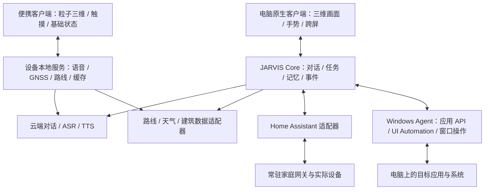

# 桌面客户端与粒子三维便携端：修订架构方案

日期：2026-10-29。根据用户补充，桌面客户端与便携板卡分别选技术；便携端裁剪功能，保留与客户端相近的粒子三维界面。本文件取代上一版分析中把便携方案绑定到 Unity、或默认降为二维地图的选型前提。以下均为设计建议，尚未更换渲染引擎、接入全屋设备或完成板卡实测。

## 1. 两个产品的明确边界

| 项目 | 电脑客户端 | 便携板卡 |
| --- | --- | --- |
| 对话、语音、天气和导航 | 保留 | 保留 |
| 能量体、粒子三维地图、状态栏风格 | 完整交互和特效 | 保留相近视觉语言，按小屏与功耗控制密度 |
| 自由建模、复杂动画、手势跨屏 | 继续扩展 | 第一阶段不要求 |
| 全屋智能、电脑控制 | 重点扩展方向 | 第一阶段不要求承担控制中枢 |
| 独立运行 | 电脑本机服务 | 设备本地运行与渲染；电脑关闭仍可用，联网调用云端 AI |
| 图形技术 | Unity、Godot、UE、Qt 等重新比较 | 可以继续 Three.js，也可原生渲染，不要求 Unity |

便携端的“基础功能”不代表普通二维界面，也不代表把电脑画面视频投到小屏。地图几何、路线粒子和能量体应在板卡 GPU 上实时绘制，触摸旋转和缩放在本地响应。只精简任务种类和运行开销。

## 2. 网页限制需要拆开判断

当前原型存在三个独立的问题域：

1. **视觉与交互制作：**空间场景、粒子形变、拾取、三维房间、复杂动画和多窗口协作，目前大量依赖手写代码。原生引擎的场景编辑器、动画工具、GPU 粒子和输入系统，能改善制作和维护流程。
2. **系统能力入口：**普通网页受到浏览器权限和生命周期约束。桌面外壳加本机服务也可以桥接原生能力，例如 WebView2 官方支持网页与宿主消息交互。因此不能把“网页不能直控设备”推导为“必须换游戏引擎才能控制”。[WebView2 原生桥接](https://learn.microsoft.com/en-us/microsoft-edge/hosting/webview2/gettingstarted)。
3. **目前服务尚未接入：**全屋设备发现、状态订阅、Windows 应用操作和任务执行，本项目还没有完整适配器。换 Unity/UE 不会自动补齐这些服务；它们需要独立设计。

用户希望扩展原生客户端是合理的产品方向，但应同时升级能力服务，避免只换了画面，电脑和家居的连接方式仍停留在原型阶段。渲染卡顿也需要区分网络、几何构建、GPU 填充率与音频链路，不能承诺换引擎全部解决。

## 3. 推荐架构：原生画面与能力服务分离

这是一种共享协议和能力模型、分别部署客户端的设计，并不要求所有功能都运行在同一台服务器。便携版有本地会话和导航状态，正常使用不依赖电脑在线。需要跨端记忆或家居远程操作时，再明确增加同步与授权网关。

### Core 与协议

先保留 Python 对话、记忆、地图规则和验证，增加明确的能力注册、任务编排与事件接口。让视觉客户端只提交动作并订阅状态，例如：

- `navigation.plan`：起点、终点、出行方式；
- `device.set`：已发现设备、目标属性和值；
- `desktop.open_app`、`desktop.arrange_window`：明确应用和窗口；
- `scene.show`：经过验证的路径、曲面、网格和动画数据。

动作返回 `task_id`，状态区分已接收、执行中、完成、失败、取消；事件携带版本、来源和目标客户端。模型提出结构化任务，服务核对能力与参数后执行，不把自然语言或生成代码直接当作系统命令。设备真实状态决定完成反馈，不能只因模型说“已开灯”就播放成功动画。

本机优先使用带身份的 loopback HTTP/WebSocket 或命名管道；跨设备另设 HTTPS/WSS 网关。当前 HTTP 接口可作为过渡，不能假定任务总线、WebSocket 和 Windows Agent 已经存在。三维粒子不逐帧走网络：传场景参数、路线、几何版本和事件，客户端持续渲染。

### 电脑控制

按目标应用能力依次使用应用官方 API/插件、Windows 系统接口、UI Automation，最后才考虑屏幕识别与鼠标键盘模拟。UI Automation 可以读取和操作许多应用暴露的控件，但并非覆盖所有软件或所有自绘界面。[Microsoft UI Automation](https://learn.microsoft.com/en-us/windows/win32/winauto/uiauto-uiautomationoverview)。

建议 Windows Agent 作为独立进程，C#/.NET 或 Python 先实现有明确边界的动作；引擎通过协议调用。录音、TTS、应用操作和网络请求放在渲染主循环之外。用户说“打开应用，放到右侧屏幕”，应先收到实际窗口结果，再驱动空间面板和粒子反馈。

### 全屋智能

优先通过 Home Assistant 接入现有品牌和协议生态；JARVIS 负责自然交互与三维房间表现。Home Assistant WebSocket API 提供动作调用和状态订阅，MQTT 适合接入自制 ESP32/传感器等设备，不等于所有商品都能直接使用 MQTT。[HA WebSocket](https://developers.home-assistant.io/docs/api/websocket/)、[HA MQTT](https://www.home-assistant.io/integrations/mqtt)。

例如“客厅灯调暗”：Core 解析客厅与灯，适配器调用实际设备实体，等待状态回执，客户端再更新房间光效。区分平台接受命令与硬件已确认；不提供回读的设备可标注推测状态。

家居网关适合放在常驻小主机、NAS 或独立网关上，不让便携电池设备承担全屋常驻中枢。桌面客户端关闭时，家庭原有自动化仍可运行。具体品牌是否支持、本地或云端连接方式、是否需要 Zigbee 协调器或 Thread 边界路由器，都按实际设备决定。

## 4. 电脑客户端：Unity、UE 与其他方案

| 方案 | 对 JARVIS 有价值的能力 | 主要代价 | 当前判断 |
| --- | --- | --- | --- |
| Unity + URP | 场景和动画编排、Shader/GPU 粒子、三维交互、C# 生态 | 需重写现有视觉层，窗口与系统能力仍需 Agent；包体与资源要控制 | 科幻互动为重点时优先验证 |
| Unreal Engine + Niagara | 粒子、材质、复杂空间和高质量视觉制作 | 开发环境与高质量场景的硬件负担较大，C++/插件和桌面窗口适配工作较多 | 有足够显卡资源、追求高规格场景时再选 |
| Godot | 三维场景、自定义 GPU 粒子 Shader、原生扩展 | 现有网页渲染仍要重写，部分工具链需自行实现 | 与 Unity 做小型对照原型 |
| Qt Quick + Qt Quick 3D | 原生桌面控件、窗口、C++/Python 生态与三维内容混合 | 高自由度特效需自行制作，不能假定比游戏引擎更省资源 | 系统工具和桌面管理比场景演出更重要时考虑 |
| WebView2 等桌面宿主 + 现有网页 | 复用代码，增加原生桥接，快速验证控制能力 | 大部分视觉制作仍沿用目前网页技术 | 过渡方案，不代替用户希望的原生视觉验证 |

Unity 的 VFX Graph 有图形 API 与硬件要求，尤其不能把全部平台支持一概而论；Godot 官方提供 GPU 粒子和自定义粒子 Shader；Qt Quick 3D 支持二维/三维混合和 Particles3D。[Unity VFX 兼容性](https://docs.unity3d.com/Packages/com.unity.visualeffectgraph@17.3/manual/System-Requirements.html)、[Godot 粒子](https://docs.godotengine.org/en/stable/tutorials/3d/particles/index.html)、[Qt Quick 3D](https://doc.qt.io/qt-6/qtquick3d-index.html)、[Qt 粒子](https://doc.qt.io/qt-6/qml-qtquick3d-particles3d-particlesystem3d.html)。

UE Niagara 很适合视觉制作；Epic 官方推荐开发硬件列出32GB内存与8GB以上显存，这是开发建议，不是每个打包程序的运行下限。考虑目前电脑较弱，不能先认定 UE 是最佳落点，也不能承诺迁移后必然更流畅。[Niagara](https://dev.epicgames.com/documentation/en-us/unreal-engine/creating-visual-effects-in-niagara-for-unreal-engine)、[UE 硬件建议](https://dev.epicgames.com/documentation/unreal-engine/hardware-and-software-specifications-for-unreal-engine)。

**当前建议：以 Unity URP 为桌面视觉首选候选，Godot 为对照；先通过真实工作负载测试再定。**测试同一能量体、粒子地图、状态栏和两窗口转场，记录低分位帧率、帧时间、显存/内存、待机功耗和音频连续性。不要同时完整重写四套客户端。

系统控制的自由度来自能力服务与协议，视觉自由度来自场景、Shader、输入和动画工具。两者分别验收。

## 5. 便携端：功能精简，粒子三维风格保留

### 优先路径

首轮建议 **RK3588/RK3588S 级平台 + 本地 Three.js/WebGL2 + 设备服务**。这是为了满足本地三维粒子负载与复用已有画面，并非为了运行 Unity。先在 Linux 图形栈或厂商支持的 Android WebView 上验证当前渲染，再决定是否需要原生改写。

Android 路线可用 Kotlin/Java 负责音频、定位和生命周期，WebView 负责粒子三维；Linux 可保留 Python 服务，Chromium 应用模式显示三维画面。正式产品若需要更强的图形和资源控制，可改为原生 OpenGL ES/Vulkan 渲染，或验证 Godot/Qt Quick 3D，但这会增加开发量。

桌面客户端采用 Unity，并不要求便携端也采用 Unity。两端共享路线/天气/场景协议、配色和交互规范；着色器与渲染实现可以不同。

### 画面如何保持相近

保留靛蓝紫色能量体、呼吸流动、细粒子纤维、能量体到三维城市的粒子变形、真实建筑轮廓、路线流动和悬浮状态栏。缩减的是超出视口的建筑、过密远景粒子、后处理分辨率与同屏复杂功能，而不是直接把地图换成二维图片。

第一轮可以用720p级显示、20–30 FPS、中心约8,000–20,000粒子、按视口预算的城市几何作为实验区间。这里只给测试起点，不是硬件承诺；需要检查拖拽、缩放、路线加载与录音同时运行时的帧时间和温度。保持GPU批处理、后台几何构建、旧画面保留与缓冲复用。

地图数据和图形表现是两件事：路线/POI 来自实际服务，建筑由具有许可的真实矢量数据构建，不使用随机城市冒充实景。高德常规地图 SDK 不会自动生成本项目的粒子城市。若 Android 原生导航 SDK 管理路线/定位，需验证能否取得所需事件与几何，再由粒子渲染器显示；SDK 自带地图和粒子地图不能无条件认为可直接替换。[高德导航入门](https://lbs.amap.com/api/android-navi-sdk/gettingstarted)。

### 硬件建议

| 平台 | 在本目标中的角色 | 选型判断 |
| --- | --- | --- |
| RK3588/RK3588S，原型建议8GB RAM、32/64GB eMMC | 首选验证平台 | 对三维图形保留余量；4GB配置可测试，8GB本身不能保证流畅 |
| Pi 5 / CM5，4/8GB版本 | 可用作对照或后续载板方向 | 要实测当前粒子着色器、后处理与显示驱动，不预设能等同 RK3588 视觉负载 |
| RK3566/RK3568 | 成本/功耗收敛候选 | 仅在相近视觉风格和运行指标均达标后采用，不能先承诺保持全部效果 |
| ESP32-S3 / MCXN947 | 辅助控制、电源、传感或语音前端 | 不作为当前粒子三维便携端的唯一主机 |

RK3588 官方列出 Mali-G610 GPU、OpenGL ES/Vulkan 与 Linux/Android 支持；RK3566 是 Cortex-A55/Mali-G52 平台。这些芯片规格不代表某块板的驱动已经通过本程序验收。[RK3588](https://www.rock-chips.com/a/en/products/RK35_Series/2022/0926/1660.html)、[RK3566](https://www.rock-chips.com/a/en/products/RK35_Series/2021/0113/1274.html)。CM5 有不同内存、eMMC 与无线版本，需要连同载板和外围评估。[CM5](https://www.raspberrypi.com/products/compute-module-5/)。

采购前优先确认：真实GPU加速的WebGL2/EGL是否可用、所选屏幕与触控是否有驱动、音频回声消除与GNSS是否已接入系统、无线联网方案和持续供电/散热。不要仅凭“支持4K/8K视频”或NPU TOPS判断粒子图形性能。

### 外围与实时运行

触摸屏、麦克风/音频codec/功放、GNSS和天线、Wi-Fi或4G、电池与电源管理构成完整设备。Android板卡应要求供应方证明GNSS能被应用通过系统定位接口读取；接入UART/USB模块并不等同于导航SDK已经取得定位。

GNSS本地更新→定位质量与坐标统一→路线匹配→更新路线进度和三维相机→确认偏航后请求重算。位置显示不需要每次都请求云端路线。天气按缓存策略刷新，云端对话使用独立ASR/对话/TTS链路；设备端保存当前路线与会话状态，电脑关闭不影响本机使用。

互联网不可用时保留已缓存路线和本地定位，不承诺实时路况或云端AI仍可用。软件更新采用签名与校验、版本化资源、健康检查和可回退发布，用户设置/数据与程序资源分离。

小屏节省像素开销，但不能消除持续三维渲染的能耗。续航需测屏幕、GPU、联网和音频的整机平均功耗，再据此设计电池与散热；不在未测量时承诺全天运行。

## 6. 共享内容与独立状态

应共享：对话/工具协议、导航数据格式、天气模型、场景JSON、错误语义、视觉配色与状态定义。桌面端的全屋/电脑工具与便携基础工具采用明确的能力集合。

应独立：每个客户端的相机、当前地图、显示比例、音频设备、生命周期及任务呈现。桌面主屏继续保留语音输入；独立副屏仍可保留自己的地图。便携设备作为单独产品可以拥有自己的麦克风，不受“电脑副屏禁止录音”这一角色规则约束。不能把副屏角色与便携角色混为一谈。

保留当前受限场景数据验证、真实地图回执和几何版本控制。原生引擎与网页均不执行云端生成的任意代码。远程访问电脑/家居能力通过单独的认证网关实现，不把当前loopback服务直接改为公网监听。

## 7. 推荐实施顺序与验收

1. **能力协议先独立：**在现有稳定界面旁定义任务/事件契约；实现一项实际电脑动作和一个实际家居设备，验证命令、失败、状态回读与客户端重连。
2. **桌面视觉验证：**用Unity URP与Godot做相同的小型场景。保持当前非全屏窗口和已验收布局，测空闲/对话/地图/跨屏/音频并发，依据效果与资源数据定引擎。
3. **便携并行验证：**直接在候选RK3588级板卡上运行粒子三维、真实路线、天气、触摸和语音；不等待桌面迁移完成，也不因为功能精简默认取消三维风格。
4. **工程收敛：**通过长时间运行、弱网、GNSS偏航、热降频、低电量、更新回滚测试后，才缩减硬件配置、设计载板和外壳。

本次只修订分析文档。当前运行程序、Windows固定根目录、配置、缓存和数据库保持原样；未来设备端路径由平台适配器另行实现。
