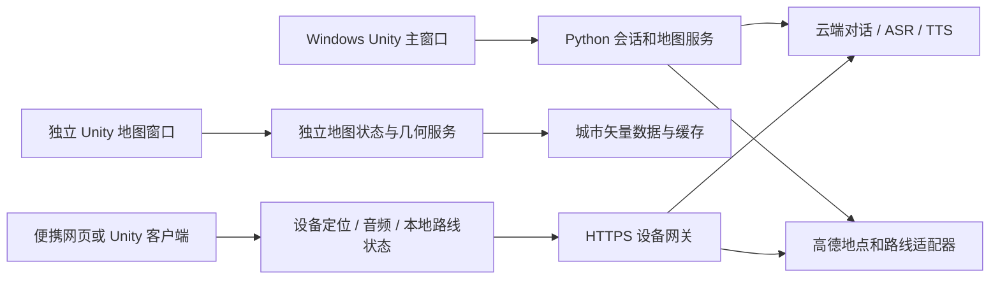

# Unity 迁移与便携 JARVIS 设计建议

分析日期：2026-10-29。本文是针对当前网页版本的设计方案，尚未开发 Unity 客户端，也没有完成任何板卡实测。Windows 现有程序继续使用 `F:\Javis_os`，配置、数据库和 API 凭证不迁移、不覆盖。

## 1. 推荐顺序

先保留现在能运行的 Python 服务和网页，完成 Windows Unity 视觉验证；便携端先验证地图、定位和语音，再决定是否使用 Unity。不要同时重写后端、渲染器和硬件系统。

如果便携款只需要地图和对话，不必等待 Unity：Linux 板卡配 Chromium 可以复用当前网页的大部分渲染代码。若未来一定使用 Unity，并希望接入成熟的移动导航能力，优先验证有稳定 Android ARM64 系统的板卡。

本文暂按 4–5 英寸触摸屏、云端 AI、设备可独立联网、基本室外定位的需求设计。尺寸、全天续航和离线要求确定后再收敛电池与主板，以下配置是开发起点，不是已经验证的整机推荐。

## 2. Unity 能复用什么，需要重做什么

| 当前模块 | 首轮 Unity 方案 | 主要工作 |
| --- | --- | --- |
| Python 对话、设置、SQLite 记忆、错误处理 | 保留为本机服务，Unity C# 调用现有 HTTP 契约 | 增加版本和能力协商；推送事件是后续优化，不假定已有 WebSocket |
| 能量体与粒子城市 | Unity URP + GPU 点云/程序化绘制 | GLSL 转 HLSL；重做材质、后处理和 GPU 缓冲生命周期 |
| 地图路线、建筑几何、坐标转换 | 复用数据定义和规则 | JS 算法改写为 C#，或服务端输出紧凑几何；真数据与视觉高度强调分开 |
| 任意提示词绘图/建模 | 保留云端输出的受限 JSON 场景协议 | C# 实现曲线、Bezier 曲面、旋转体、网格、分部关键帧采样；继续禁止执行生成代码 |
| SVG 路径绘图 | 复用路径数据，不能直接复制浏览器 Path2D | 实现或选用经许可审查的路径解析/采样组件 |
| Windows 播报和本地唤醒 | Windows 原型先复用 Python 音频服务 | Android/Linux 换录音、播放、唤醒适配器，不复制 System.Speech |
| MediaPipe 网页手势 | 保留动作协议和测试用例 | 换原生插件或独立推理服务；浏览器 Worker 不能直接移入 Unity |
| 分屏传送 | 主窗口、独立地图窗口各自持有状态 | 沿用预热→离场→派送→入场→组装完成协议和窗口代次 |

推荐的目标结构如下，图中事件推送与设备网关属于待实现部分：

### 渲染设计

首个原型采用 URP，先保持当前约两万中心粒子的级别。每粒子保存源位置、目标位置、随机种子、颜色和所属部件；GPU 根据时间和状态插值，CPU 不逐帧上传整座城市。待机呼吸、听取、转写、思考和说话是不同状态，地图和模型保持专用表现。地图传送也复用粒子目标位置，不在切换时创建大量对象。

VFX Graph 可以用于视觉制作，但不能把它当作所有移动板卡的默认保障。官方 17.3 文档要求 Compute Shader，且明确 URP 平台支持存在限制；原型应检测图形能力，保留普通点云 Shader 的降级路径。[VFX Graph 兼容性](https://docs.unity3d.com/Packages/com.unity.visualeffectgraph@17.3/manual/System-Requirements.html)。

移动端先以 720p/约 20–30 FPS、中心 5,000–12,000 粒子、分层建筑与道路预算作为实验目标；这些数字需要在选定屏幕与板卡上测量，不能从桌面成绩推导。只在视口变化时请求/重建几何，限制未完成任务，丢弃过期结果，复用 GPU 缓冲。高温、低电量时减少辉光、像素比和建筑细节。

### 地图与分屏的关键差异

当前项目用高德 JS SDK 获取地点和路线，使用公开矢量数据构建粒子城市，并非拥有完整高德三维城市模型。迁移不能凭空提高地图精度，也不能以随机建筑替代缺失数据。

Unity 原生端不直接复用浏览器 JS Key：Windows/Linux 自绘地图可接 Web 服务接口，另申请对应平台 Key；Android 使用官方地图/定位/导航 SDK 时，需要原生插件桥接以及正确的包名和签名绑定。保留建筑数据来源标注与许可。[Web 服务 Key](https://lbs.amap.com/api/webservice/guide/create-project/get-key)、[Android 导航配置](https://lbs.amap.com/api/android-navi-sdk/guide/create-project/configuration-considerations)。

完整移动导航还需要位置融合、道路匹配、偏航重算、转向播报与后台定位，路线规划接口本身不等于导航引擎。可先做“定位 + 路线进度 + 下一转向”原型，再按 SDK 能力和许可决定自绘粒子画面如何接收导航事件。[高德导航入门](https://lbs.amap.com/api/android-navi-sdk/gettingstarted)。

Windows 的独立地图建议采用第二个 Unity 进程，以保留普通窗口、独立退出及主屏操作不影响副屏的语义。Unity 多显示器摄像机并不自动提供这些隔离能力。接收端先隐藏预热，主屏粒子完成离场后再显现；副屏只有地图操作权限，麦克风和对话仍归主屏。

## 3. 板卡怎么选

| 目标 | 开发起点 | 能实现什么 | 选型边界 |
| --- | --- | --- | --- |
| 尽量保留三维地图，兼顾未来 Unity | RK3588 系列板卡，建议 8 GB RAM + 64 GB eMMC；例如 Orange Pi 5 Plus 原型 | 网页 GPU 渲染、音频、GNSS、云端 AI；验证 Android ARM64 后再跑 Unity | 核对具体系统镜像、GPU 驱动和触屏；5 Plus 无线联网需另外选模块，不把 Wi-Fi 插槽当成已装 Wi-Fi |
| 优先复用网页和 Python，文档与后续载板开发方便 | Raspberry Pi 5 4/8 GB 原型；缩小整机时考虑带无线的 CM5 4 GB + 32 GB eMMC | Linux + Chromium、自绘地图、定位和云端对话 | 需要散热及完整供电设计；ARM Linux 不能直接使用标准 Unity 桌面 Linux 包 |
| 小屏、低功耗、简易随身助手 | ESP32-S3，建议带至少 8 MB PSRAM、16 MB Flash 的模块 | LVGL 文字/箭头/简化路线，本地唤醒与音频采集、云端对话 | 不承载当前 Three.js/WebGL 城市或 Unity；复杂渲染需删减或交由另一设备 |

以上是工程判断。Orange Pi 5 Plus 官方资料列出 RK3588、eMMC 扩展与 Wi-Fi/蓝牙模块插槽；采购前应让供应方提供目标系统的图形演示和长期维护说明，不能只看芯片参数。[Orange Pi 官方规格](https://www.orangepi.org/html/hardWare/computerAndMicrocontrollers/details/Orange-Pi-5-plus.html)。

Raspberry Pi 5 官方要求关注 5V/5A 电源，并建议重负载主动散热；CM5 提供不同内存、eMMC 和无线版本，后续可以定制载板。云端 AI 情况下，优先考虑图形驱动、音频、网络和功耗，NPU TOPS 不是首要购买指标。[Pi 5 规格](https://www.raspberrypi.com/products/raspberry-pi-5/)、[CM5 规格](https://www.raspberrypi.com/products/compute-module-5/)。

ESP32-S3 属于 MCU，官方列出双核 240 MHz、512 KB 内部 SRAM 与可扩展 PSRAM；适合简化交互终端，不应承诺复刻完整城市界面。现有 MCXN947 也更适合控制和传感协作，本方案不把 MCU 作为完整三维界面的主机。[乐鑫板卡选择指南](https://docs.espressif.com/projects/esp-techpedia/en/latest/esp-friends/get-started/board-selection.html)。

**如果现在就开始便携验证：**优先先用现有 Android 手机验证独立定位、对话和导航流程；确认流程后，再在具备相同 Android 图形/音频能力的 RK3588 开发板上验证。若近期沿用网页，则 Pi 5 或具备合适 Linux 图形驱动的 RK3588 都是可测方案，不为“以后可能用 Unity”立刻定制 PCB。

### Unity 的 ARM Linux 限制

标准 Unity 桌面 Linux Player 的要求列为 x64；Embedded Linux 另列 ARM64 支持。两者不能混为一谈。ARM Linux 板卡上的 Unity 路线需要核对 Embedded Linux 平台包、芯片/驱动组合和授权；可考虑先验证板卡 Android 版本。Unity 官方还区分内部原型与商业嵌入式部署，商品化前需要确认相应方案。[Unity 6.3 系统要求](https://docs.unity3d.com/6000.3/Documentation/Manual/system-requirements.html)、[Unity 嵌入式支持与部署说明](https://unity.com/solutions/embedded)。

## 4. 便携整机需要哪些外围

- 屏幕：4–5 英寸触摸屏作为起点；优先厂商已验证的 DSI/HDMI 方案，不能仅凭接口外形判断兼容性。
- 定位：USB/UART GNSS 接收机和合适天线；Wi-Fi/IP 城市定位无法替代户外导航。坐标必须明确 WGS84/GCJ-02，GNSS、路线和建筑统一后再投影。
- 网络：首版手机热点；要求脱离手机时增加有目标系统驱动的 4G 模块、SIM、数据套餐与天线，检查弱网和峰值电流。
- 音频：USB 音频原型或 I2S 麦克风 + codec + 扬声器功放。便携常开语音需要回声消除、降噪和播放/唤醒协作，不能只接一只麦克风就承诺连续对话。
- 电源：电池、充电与保护、稳压、剩余电量检测、关机流程和散热作为整机一起设计。开发板额定电源是供电能力要求，不等于恒定耗电。

续航用实际整机功耗计算。例如假设电池 3.7V × 5Ah = 18.5Wh、有效转换效率 85%、屏幕与通信在内的实测平均功耗 8W，则约为 `18.5 × 0.85 / 8 ≈ 2 小时`。这只是估算例子；若要求一整天便携，需降低界面/屏幕功耗、增大电池或选择更低功耗平台，不能只增加 RAM。

## 5. “实时更新”分三条链路

### 定位和路线实时更新

GNSS → 本地过滤与定位质量判断 → 道路/路线匹配 → 更新位置、剩余距离和转向提示 → 确认偏航后重算。

建议原型以 1–5 Hz 接收位置，渲染通过插值平滑；这不是每秒请求高德 1–5 次。当前位置与路线进度在设备上计算；偏航加入准确度阈值、持续时间与冷却，确认后再请求新路线。路况可尝试 30–60 秒、天气 10–15 分钟刷新，这些只是设计起点，需要按服务权限、配额和场景调整，不能把接口当作无限调用。

缓存当前路线、必要的附近数据和上次有效位置；无网时保留已有路线和本地位置进度，明确标记离线与位置质量，不能宣称还能获得实时路况或无限离线重算。

### 对话和云端能力更新

本地唤醒/VAD → 命令录音 → 流式 ASR/对话 → 分段 TTS → 单一播放队列。若 ASR 服务不提供流式接口，则保持录完转写并显示状态，不声称已实现全双工。

生产设备建议通过 HTTPS 网关管理服务商凭证、设备身份和调用额度。对话用 SSE/WebSocket 等流式通道，地图几何按视口缓存与更新；避免把整个粒子数组不断从云端传回来。不能直接将目前仅供 loopback 的 Python 服务开放到公网。

### 软件 OTA 更新

区分网页资源热更新、应用升级和系统镜像升级。采用签名版本清单、下载校验、版本化资源、健康检查与回滚；系统或固件升级使用双槽/A-B 策略。配置、数据库和缓存与程序分区分离，数据库升级要兼容回退。

ESP32 路线可使用 ESP-IDF 的两个 OTA app 槽、启动后验证和回滚机制；Linux/Android 需选对应的系统更新方案，不能照搬 MCU 分区方式。[ESP-IDF OTA 与回滚](https://docs.espressif.com/projects/esp-idf/en/stable/esp32s3/api-reference/system/ota.html)。

## 6. 分阶段验收

1. **Windows Unity 视觉原型：**同一场景 JSON 在网页与 Unity 都能显示；空闲持续运动，思考与说话不同形态；地图和模型不被对话形态覆盖。比较帧耗、内存和加载时间，不能默认换引擎就更快。
2. **Windows 功能迁移：**对话流、字幕与音频同步；F2 设置等价；真实路线、360 度拖拽、起终点完整性、粒子转场及独立副屏均通过原有用例。
3. **板卡验证：**选定系统和屏幕上连续运行，记录平均/低分位 FPS、温度、内存、音频断续和整机瓦数；室外检验 GNSS、弱网、偏航、热点/4G 重连。先过这一步再做载板。
4. **便携工程样机：**断电/低电量关机、更新中断回滚、凭证隔离、数据库迁移、长时间导航和续航测量通过后，再讨论量产和外壳。

当前 Windows 路径约束不会因为分析而改变。真正移植时应增加 RuntimePaths 平台适配器：Windows 保持固定根目录；设备使用它自己的应用私有目录。这里是未来接口设计，并未在本机创建任何设备端路径。
